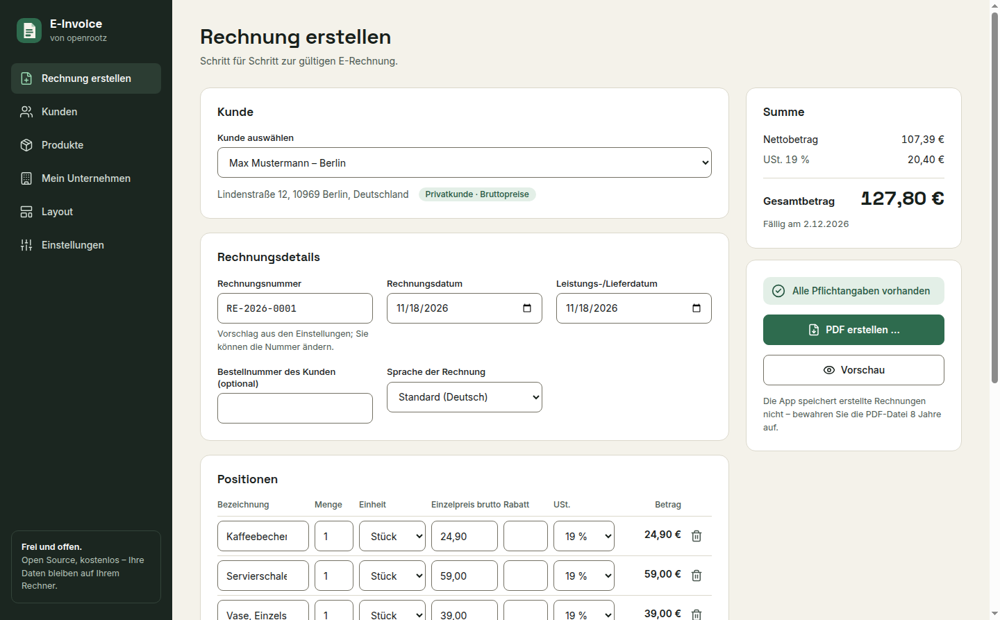
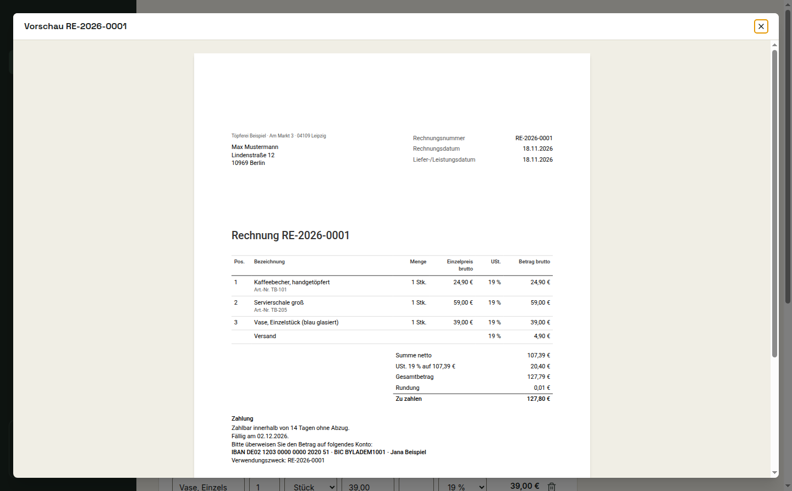
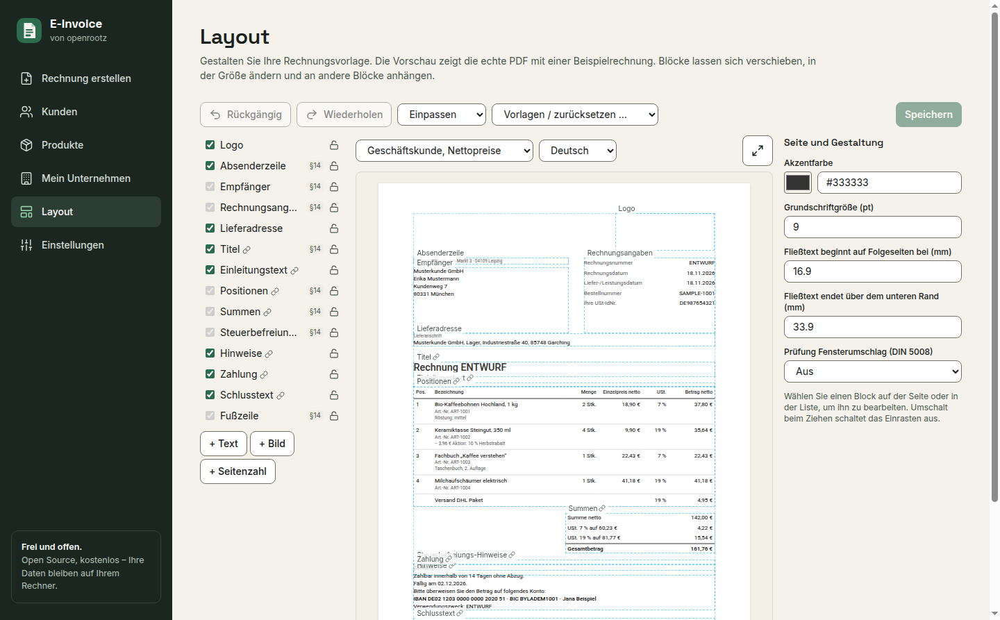

# E-Invoice Desktop

[](https://github.com/OpenRootz/e-invoice-desktop/actions/workflows/ci.yml)
[](https://github.com/OpenRootz/e-invoice-desktop/releases/latest)
[](LICENSE)
[](#validated-output)

A free Windows app for writing **ZUGFeRD / Factur-X** e-invoices (profile EN 16931, PDF/A-3b with the CII XML
embedded). It is made for small businesses that mostly sell to consumers and now and then to other businesses: a
shop, a workshop, a freelancer. No account, no subscription, no cloud: the app never connects to the internet, and
your data stays on your computer.

The user interface is in German and English.



## Why

In Germany, every business must be able to receive e-invoices since 2025. **Issuing them becomes mandatory for
invoices to other businesses from 2027** (turnover above €800k) and for almost everyone from 2028. A PDF from a word
processor is then no longer an invoice for business customers: it needs a structured, validated EN 16931 data set.

A ZUGFeRD PDF covers both cases. Consumers get a normal, readable PDF; businesses get the same file with the
machine-readable invoice inside. The app helps with the rules as well: it checks the information § 14 UStG and
EN 16931 require before it creates an invoice and explains in plain words what is missing.

## Features

- **ZUGFeRD / Factur-X** (EN 16931 profile), checked with the official validators in CI.
- **Consumers and businesses**: gross prices for consumers, net prices for businesses, VAT IDs for business
  customers. The prices in your products can be entered with or without VAT.
- **Quick entry**: pick a saved customer or type the address straight into the invoice (and save it for next time
  with one switch). Add saved products or free-text lines, for example for one-off items you never put into a
  product list.
- **Checks before export**: missing seller data, a missing tax number or identifier, an incomplete customer address,
  a missing IBAN for bank transfers. On "My business", typing mistakes such as a wrong IBAN check digit or a
  malformed VAT ID are pointed out while you type.
- **Small businesses** under § 19 UStG: no VAT, with the required note on every invoice.
- **Invoice numbers** from a pattern such as `RE-{YYYY}-{NNNN}`, optionally starting at 1 every year. The app
  suggests the next number; you can change it.
- **Visual layout editor**: move and resize the blocks of the invoice on the real PDF, presets for DIN 5008 form A
  and B, your logo, colours and texts. The editor makes sure that everything § 14 UStG requires stays on the page.
- **Payment**: bank transfer (with IBAN and due date), cash, card, PayPal or other; invoices can be marked as paid.
- **Offline and private**: no network access at all, no telemetry, no updates in the background.

| The invoice as PDF                                       | Layout editor                                                            |
| -------------------------------------------------------- | ------------------------------------------------------------------------ |
|  |  |

## Contents

- [Download and installation](#download-and-installation)
- [Getting started](#getting-started)
- [Your data](#your-data)
- [How invoices are calculated](#how-invoices-are-calculated)
- [Validated output](#validated-output)
- [Legal notes](#legal-notes)
- [Limitations](#limitations)
- [Development](#development)
- [Contributing](#contributing)

## Download and installation

Download the latest version from the [releases page](https://github.com/OpenRootz/e-invoice-desktop/releases/latest).
It runs on Windows 10 and 11 (64-bit).

| File                                       |                                                                             |
| ------------------------------------------ | --------------------------------------------------------------------------- |
| `e-invoice-desktop-X.Y.Z-setup-x64.exe`    | installer with a start menu entry; can be uninstalled as usual              |
| `e-invoice-desktop-X.Y.Z-portable-x64.exe` | a single program file that runs without installation, e.g. from a USB stick |
| `SHA256SUMS.txt`                           | checksums to verify the download (`certutil -hashfile <file> SHA256`)       |

The program files are not code-signed yet. On the first start, Windows SmartScreen therefore warns that the app is
from an unknown publisher: choose **More info → Run anyway**. Only download the app from the releases page of this
repository.

The app does not update itself. To update, download and install the new version; your data is kept.

## Getting started

1. **My business** (Mein Unternehmen): your name, address, contact, tax number, VAT ID or business identification
   number (W-IdNr.), bank account and payment terms. The page marks what is required and shows an example for every
   field. Invoices can only be created once the required fields are complete.
2. Optionally **Layout**: add your logo on "My business", then adjust the design of the invoice. The preview is
   the real PDF.
3. **Create invoice** (Rechnung erstellen): enter or pick the customer, add the lines, check the totals and click
   **Create PDF**. The app asks where to save the file.
4. **Keep the PDF.** The app does not keep a copy of your invoices (see [Your data](#your-data)).

Customers and products are optional. They save typing for regular customers and recurring items.

## Your data

The app stores your master data as four JSON files in `%APPDATA%\E-Invoice Desktop` (the exact folder is shown under
Settings):

| File             | Content                                                |
| ---------------- | ------------------------------------------------------ |
| `seller.json`    | your business, bank account, logo and invoice defaults |
| `customers.json` | saved customers                                        |
| `products.json`  | saved products                                         |
| `settings.json`  | language, invoice numbering and layout                 |

- **Invoices are not stored by the app.** You choose where each PDF is saved. Keep the files for at least 8 years
  (§ 147 AO) and include them in your backup.
- **Back up the data folder** together with your invoices. There is no cloud sync and no automatic backup.
- The installer and the portable version use the same folder. Uninstalling the app keeps it.
- A file that cannot be read (e.g. after editing it by hand) is renamed and set aside instead of being overwritten,
  and the app tells you about it. Files written by a newer version of the app are never overwritten by an older one.

The app makes no network connections: it has no update check, no telemetry and no web fonts, and it blocks any
request that does not go to its own files.

## How invoices are calculated

Amounts are calculated in whole cents, never with floating point numbers.

- **Net prices** (business customers): the VAT per rate is calculated on the net total of that rate.
- **Gross prices** (consumers, or if "prices include VAT" is set): the amount due is exactly the sum of the gross
  prices you entered. The VAT is calculated from the net total per rate as EN 16931 requires; the difference of a
  cent or two to your gross total appears as **rounding** (Rundung, BT-114) in the totals of the invoice.

Please confirm the setup with your tax adviser, in particular the VAT rates you use.

## Validated output

The CI pipeline creates invoices for a set of scenarios (consumers with gross prices, businesses with net prices,
mixed VAT rates, small businesses, a seller with a tax number only, rounding cases, custom layouts) and through the
same code path the app uses, then validates every file with:

| Validator                                                                                    | Checks                                             |
| -------------------------------------------------------------------------------------------- | -------------------------------------------------- |
| [KoSIT validator](https://github.com/itplr-kosit/validator) with the XRechnung configuration | EN 16931 rules                                     |
| [Mustang](https://www.mustangproject.org/)                                                   | ZUGFeRD / Factur-X: PDF, embedded XML and metadata |
| [veraPDF](https://verapdf.org/)                                                              | PDF/A-3b                                           |

Online validators that check against **XRechnung** may show information notices such as BR-DE-15, BR-DE-21 or
PEPPOL-R010. These rules apply to XRechnung invoices for public authorities, not to ZUGFeRD.

## Legal notes

This app helps you create compliant e-invoices; it is not tax or legal advice.

- Have your tax adviser confirm your setup.
- **Invoice numbers** must be unique. The app suggests the next number from your pattern, but you can change it,
  and it does not keep a list of issued invoices. Keep your number sequence without gaps.
- **Retention**: keep every invoice for at least 8 years (§ 147 AO). The app never stores or deletes invoices.
- **GoBD**: the app does not archive. Your overall process (storing the PDFs unchanged, backups, procedure
  documentation) determines whether you meet the GoBD.

## Limitations

- Windows only. The app is built with Electron and could run on macOS and Linux, but there are no packages for them.
- Invoices only: no credit notes, cancellations or quotes yet.
- ZUGFeRD only; no XRechnung for public authorities (Leitweg-ID) and no Peppol sending.
- No invoice list or archive, no sending by email.
- One business per installation, prices in euros.

Feedback on what matters to you is welcome in the [issues](https://github.com/OpenRootz/e-invoice-desktop/issues).

## Development

Requirements: Node ≥ 22, [pnpm](https://pnpm.io) 11, Docker for the validators.

```bash
pnpm install
pnpm dev                    # the app with hot reload
pnpm test                   # unit tests; writes sample PDFs to test/__output__
pnpm typecheck
pnpm lint                   # ESLint (pnpm lint:fix to fix what can be fixed)
pnpm format                 # Prettier (pnpm format:check in CI)
pnpm build                  # main, preload and renderer → out/
pnpm validate test/golden   # KoSIT, Mustang, veraPDF (Docker)
pnpm validate test/__output__/app # the PDFs written through the app's invoice service
pnpm dist:win               # Windows installer and portable exe → release/ (run it on Windows)
```

The EN 16931 core (invoice model, calculation, CII XML, PDF rendering with
[pdfmake](https://pdfmake.github.io/docs/)) is shared with the
[Vendure E-Invoice Plugin](https://github.com/OpenRootz/vendure-plugin-e-invoice).

CI runs lint, formatting and `pnpm audit --prod` next to the tests and validators; CodeQL scans the code and the
workflows, and Dependabot proposes dependency and GitHub Actions updates weekly. Pushing a version tag builds the
Windows packages on a Windows runner and publishes them as a GitHub release (see [CONTRIBUTING.md](CONTRIBUTING.md)).

## Contributing

Bug reports, questions and ideas are welcome as [issues](https://github.com/OpenRootz/e-invoice-desktop/issues).
Please read [CONTRIBUTING.md](CONTRIBUTING.md) first, and report security issues privately as described in
[SECURITY.md](SECURITY.md). This project follows a [code of conduct](CODE_OF_CONDUCT.md).

## License

[MIT](LICENSE) © openrootz
